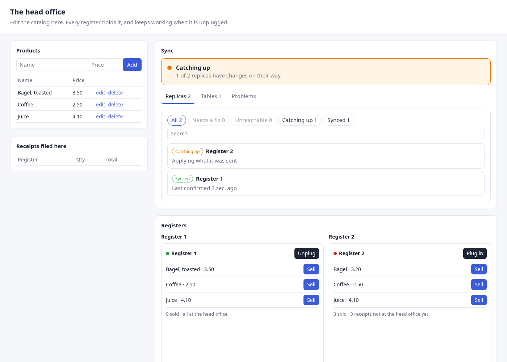

# The dashboard

The engine answers what a dashboard asks ([Progress and
health](progress.md)); `magic_sync_dashboard`, on npm, draws it in Vue 3. In
between are your handlers: the dashboard fetches nothing, and the engine
serves no HTTP. That is on purpose — *who may see which replicas* is your
system's question, asked behind your login, and the engine only takes the
answer as a scope.



## The handlers

> **You write** the reads, in whatever your server is built with. The
> shop's, in axum (`examples/shop/server/src/main.rs`):

```rust,ignore
{{#include ../../../examples/shop/server/src/main.rs:dashboard}}
```

The shop has no login, so it asks over every register (`Scope::All`). A
system with one answers for the caller instead: a customer's partition
(`Scope::Partition`), or the replicas this user may see
(`Scope::Replicas(&ids)`). Each read takes a connection and reads one snapshot
of its own. The answers serialize as they are; return them untouched, and the
dashboard of the same version reads them — an answer of another contract
version it refuses, saying so, rather than draw it wrong.

> **What happens:** the overview reads only what the engine records, so it
> answers in milliseconds for hundreds of replicas that are caught up — a
> fifth of a second at worst, while a whole fleet has rows on their way — and
> the page can ask every few seconds. It counts every replica but lists only
> the worst twenty; the listing pages through the rest, in one state or all.
> Progress counts what one replica should hold: ask it for the one being
> looked at, not for the fleet.

## The page

```sh
pnpm add magic_sync_dashboard
```

> **You write** the fetching, and your names for what the engine knows by
> id. The shop's (`examples/shop/web/src/App.vue`), where `api` is a `fetch`
> of each handler above (`examples/shop/web/src/api.ts`):

```ts
{{#include ../../../examples/shop/web/src/App.vue:script}}
```

```vue
{{#include ../../../examples/shop/web/src/App.vue:dashboard}}
```

and its styles, once, where the app starts (`examples/shop/web/src/main.ts`):

```ts
import 'magic_sync_dashboard/styles.css'
```

> **What happens:** a banner says in one line where things stand — green,
> *everything is in sync*, most of the time; amber while changes are on their
> way or a replica is out of reach; red when something waits for a fix — then
> the replicas, worst first, the tables, and the problems, each with its
> reason. Picking a state, or turning a page, sets `filter` or `offset`; you
> fetch that page of the listing. Without a listing, the dashboard shows the
> overview's worst and says how many there are in all. Clicking a replica
> sets `selected`; you fetch its progress, and it shows table by table. How
> long ago something happened is measured from the server's `now` in the
> answer, moved on by the time passed in the page — the browser's clock is
> never compared with the server's.

## Where one row is

"Which registers hold this product?" is asked next to the product, in your own
listing — not on the dashboard, which knows rows only by key. The shop puts a
*who holds it?* link on each product: it asks the `row` handler with the
product's id (`places`, above), and shows the answer with `RowPlaces`, under
the product:

```vue
{{#include ../../../examples/shop/web/src/App.vue:row}}
```

> **What happens:** each register, and where the row stands on it — holds it,
> holds an older version, on its way, letting it go, or set aside. In a system
> with many listings, the same link on each listing of a table that travels
> answers "which units hold this operator", "which hold this order".

## Wishes

A replica's line says how many wishes of its settings it has not carried
out, is waiting to, refused, or found changed there first ([Settings and
wishes](settings.md)); a replica with one it has not answered is catching
up. One waiting is answered — the replica tries it again by itself, and its
reason says what it waits for — so it does not keep the replica from synced.
`Engine::wishes` lists them — those that need attention first — for
`WishList` to show, each with its replica's answer and why.

## Its look and its words

Its look is CSS variables (`--msd-accent`, `--msd-ok`, …) you may set to your
own tokens on any ancestor; the defaults keep every text at a contrast of
4.5:1 or more, which a test of the stylesheet holds them to. Its words are
English or Spanish, following your `vue-i18n` locale, each a whole sentence
whose counts take the locale's plural forms. A system with a design system of
its own skips the ready-made component and draws the same answers with its
own parts, through `useSyncDashboard` and the sentence functions of
`magic_sync_dashboard/core`: the package's README says how.

## One version, both sides

The dashboard's types are generated from the engine's (`status.rs`'s test
writes `dashboard/src/core/contract/types.ts`), and the engine's own test
writes what it answers, every state and every kind of problem, into the
dashboard's fixtures, which its type-check holds field for field to those
types. A field renamed on one side fails the other's build. Release and
upgrade the crate and the package together: they carry the same version.
