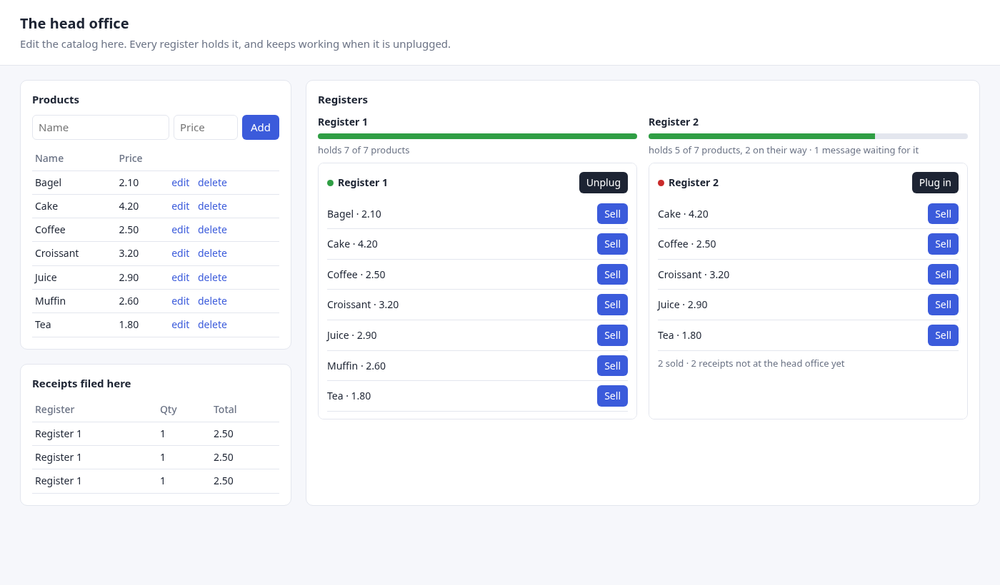

# Introduction

`magic_sync` keeps partial copies of PostgreSQL tables on SQLite replicas,
and brings back what the replicas write.

Picture a chain of shops. The head office runs PostgreSQL. Every cash register
runs SQLite and must keep selling when the network is down. The registers
hold the catalog; each register writes receipts that the head office must end
up with. That is the system this book builds, one step at a time, and it is
also the [example](https://github.com/rsansores/magic_sync/tree/main/examples/shop)
you can run in five minutes.

## How the book is written

Every chapter of *Build your own* has two kinds of block:

> **You write** — code that is yours: copy it, change it.

> **What happens** — what the engine does with it. You can skip these and
> come back when you want to know.

*Under the hood* is the engine from the ground up, for when you want to
understand all of it: the idea it rests on, the life of a change, every
failure and how it heals, and the protocol a replica in any language follows.

## The idea, in one paragraph

Most sync engines replay a log of events. This one compares states: for every
replica, the server keeps what that replica holds, works out what it should
hold, and sends the difference. A change is a reason to compare again, never
an event that must be delivered. That one choice is why a replica can be away
for a week and catch up from the current state, why a failing row does not
block the ones behind it, and why nobody ever repairs data by hand.
